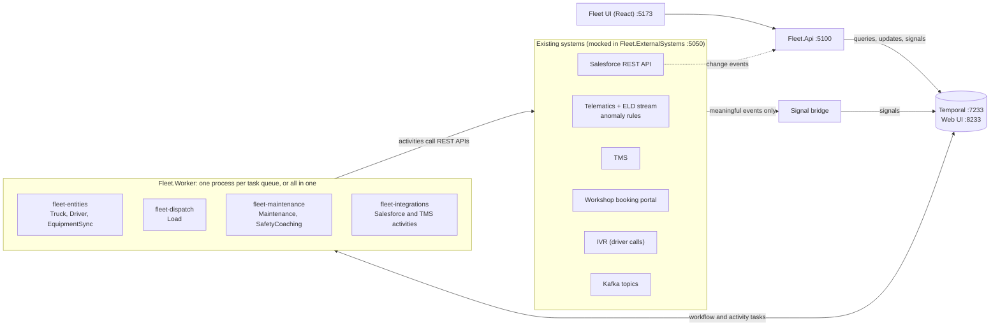

# Fleet control on Temporal

A runnable fleet management demo built with the [Temporal](https://temporal.io) .NET SDK. A simulated fleet of 24 trucks and 24 drivers moves across a US interstate network while Temporal workflows handle dispatch, maintenance, driver safety and integration with the systems around them: a CRM (Salesforce), a transportation management system (TMS), workshop booking, an IVR for driver calls, and Kafka.

You drive the demo from a fleet control UI: a live map, lists of trucks, loads, repairs and drivers, an approvals inbox, and a runbook of scenarios and failure switches. Every truck, driver, load and repair in the UI is a running workflow, and each one links straight to its event history in the Temporal UI.

Step-by-step scenarios are in [DEMO_SCRIPT.md](DEMO_SCRIPT.md).

## What the demo covers

- **Entity workflows.** Each truck and each driver is a long-lived workflow that owns its state. Loads reserve trucks and drivers through validated Workflow Updates, so double-booking a truck, or booking one that is in the shop, is impossible.
- **Long-running business processes.** A repair case runs from the first telematics anomaly to the closed work order. It can wait for the current delivery to finish, ask a fleet manager for approval, escalate when a workshop does not answer, tow the truck, and record what the repair cost.
- **Partner and general workshops.** Partner workshops have negotiated rates, about 70% below a general workshop invoice. The policy prefers a partner when the truck can safely get there, and the UI tracks the savings.
- **Human in the loop.** Approvals, coaching follow-ups and loads without a truck appear in an inbox. Decisions are Workflow Updates, validated by the workflow and answered synchronously.
- **Sagas and compensation.** Reservations are undone when a later step fails, and a cancelled repair case withdraws its workshop requests, releases the truck and closes the work order.
- **Durable timers.** Vendor response windows, approval timeouts, detention at the shipper, onboarding steps and call retries are all server-side timers.
- **Integration resilience.** Salesforce and TMS calls run on their own task queue with a retry policy. Outages, rate limits and expired sessions only delay work. Upserts keyed on external IDs and versioned writes prevent duplicates and out-of-order state.
- **Events from outside.** Telematics anomalies, geofence arrivals, workshop answers and call acknowledgments arrive as signals. Duplicate and out-of-order events are handled in the workflows.
- **Scheduled reconciliation.** A Temporal Schedule reads Salesforce, starts any missing truck and driver workflows, and fixes TMS records that drifted.
- **AI inside a workflow (optional).** Claude can recommend the workshop. The call is an ordinary activity: retried, recorded in history, and backed by a policy engine if it fails. Approval rules always come from policy, not from the model.
- **Operability.** Kill a worker and its work pauses, then resumes from the same step. Visibility queries over search attributes replace an application database. A time-skipping test and a replay test cover the workflows.

## Architecture



`Fleet.ExternalSystems` stands in for the systems a fleet operator usually already runs. The telematics position stream never touches a workflow; a small bridge turns meaningful events (an anomaly, a geofence arrival, a workshop's answer) into signals, which is the role a Kafka consumer or webhook would play in production. Workers only make outbound connections, so they can run in a private network next to internal APIs.

| Process | Project | Port | Role |
|---|---|---|---|
| Temporal dev server | Temporal CLI | 7233, UI 8233 | Durable execution, visibility, schedules |
| External systems | `src/Fleet.ExternalSystems` | 5050 | Salesforce, TMS, telematics simulator, workshop portal, IVR and Kafka mocks; failure switches |
| Workers | `src/Fleet.Worker` | none | Run workflows and activities, one task queue each by default |
| Fleet API | `src/Fleet.Api` | 5100 | Backend for the UI: queries, updates, signals, scenarios |
| Fleet UI | `ui` | 5173 | Map, lists, detail panels, inbox, runbook |

### Workflows

| Workflow | ID | Pattern | Responsibilities |
|---|---|---|---|
| `TruckWorkflow` | `truck-{unit}` | Entity, continue-as-new | Only writer of truck status; validated reservations; merges related anomalies into one open case; versioned writes to the TMS |
| `DriverWorkflow` | `driver-{id}` | Entity, continue-as-new | Onboarding; hours of service from the ELD; safety events held until the driver stops |
| `LoadWorkflow` | `load-{id}` | Saga | Plans and reserves truck and driver with compensation, records TMS milestones in order, runs the detention timer, re-powers after a breakdown |
| `MaintenanceWorkflow` | `maint-{unit}-{n}` | Long-running, human in the loop, saga | Defers until delivery, ranks workshops, AI or policy recommendation, approval with timeout, workshop escalation, tow, repair, close; cancellation with compensation |
| `SafetyCoachingWorkflow` | `coaching-{driver}-{n}` | Durable retries, escalation | Salesforce case, three call attempts, then a person |
| `EquipmentSyncWorkflow` | Schedule `fleet-equipment-sync` | Scheduled reconciliation | Starts missing entity workflows from Salesforce; fixes TMS drift |

## Prerequisites

- .NET SDK 8 or later. The projects target `net8.0` and roll forward to newer runtimes.
- Node.js 18 or later
- Temporal CLI: `brew install temporal` (macOS), `winget install Temporal.TemporalCLI` (Windows), or download from https://temporal.download/cli
- Internet access on the first build (NuGet and npm packages). The UI loads the Overpass font from Google Fonts and falls back to a system font offline.

## Quick start

Windows (PowerShell):

```powershell
scripts\start-all.ps1
```

macOS or Linux:

```bash
scripts/start-all.sh
```

The script builds the solution, installs the UI packages on first run, and starts every process (one window per process on Windows; background processes with logs in `.logs/` on macOS and Linux).

Then open:

- http://localhost:5173 for the fleet UI
- http://localhost:8233 for the Temporal UI

Within about 20 seconds the API creates the equipment-sync schedule and triggers it. That run reads Salesforce and starts the 24 truck and 24 driver workflows, and a first batch of loads is tendered. Open **Demo runbook** in the top right to start running scenarios.

Stop everything with `scripts\stop-all.ps1` or `scripts/stop-all.sh`. The dev server is in-memory, so the next start is a clean slate.

### Running the pieces by hand

Build once, then start each process in its own terminal with `--no-build`. Several `dotnet run` builds of the same project at once collide on `bin/obj`.

```bash
dotnet build FleetDemo.sln
temporal server start-dev --ui-port 8233 --search-attribute FleetEntity=Keyword --search-attribute FleetStatus=Keyword --search-attribute UnitNumber=Keyword --search-attribute NeedsAttention=Bool
dotnet run --no-build --project src/Fleet.ExternalSystems
dotnet run --no-build --project src/Fleet.Api
cd ui && npm install && npm run dev
```

Workers: pick one layout. Every task queue needs at least one worker, or the work on it waits.

```bash
# A) One process for all four task queues
dotnet run --no-build --project src/Fleet.Worker

# B) One process per task queue (what start-all does; lets you stop any one of them)
dotnet run --no-build --project src/Fleet.Worker -- --queues entities       # Truck, Driver, EquipmentSync workflows
dotnet run --no-build --project src/Fleet.Worker -- --queues dispatch       # Load workflows
dotnet run --no-build --project src/Fleet.Worker -- --queues maintenance    # Maintenance and SafetyCoaching workflows
dotnet run --no-build --project src/Fleet.Worker -- --queues integrations   # Salesforce and TMS activities

# C) Two processes: maintenance on its own, so Ctrl+C there stops one worker
dotnet run --no-build --project src/Fleet.Worker -- --queues entities,dispatch,integrations
dotnet run --no-build --project src/Fleet.Worker -- --queues maintenance
```

### Helper scripts

| Script (`.sh` and `.ps1`) | Purpose |
|---|---|
| `start-all` | Build and start everything |
| `stop-all` | Stop everything started by `start-all` |
| `start-temporal` | Start the dev server with the demo's search attributes |
| `worker <queue>` | Start one worker (`entities`, `dispatch`, `maintenance`, `integrations` or `all`) |
| `stop-worker <queue>` | Hard-kill one worker, for the recovery scenario |
| `export-history <workflowId>` | Save a workflow history for the replay test |

## Tests

```bash
dotnet test
```

- `MaintenanceWorkflowTests` runs a full repair case on the time-skipping test server: a workshop that never answers (2 hours, skipped instantly), one that declines, a partner workshop that accepts, and a completion event that arrives twice and before the arrival event. The first run downloads the test server binary.
- `ShopFinderTests` covers workshop ranking and the approval policy.
- `ReplayTests` replays any histories in `tests/Fleet.Tests/histories` against the current workflow code. Export one with `scripts/export-history.sh <workflowId>`. See [docs/live-change/README.md](docs/live-change/README.md) for an exercise that uses it.

## Configuration

Each .NET process reads `appsettings.json` next to its binary. Any value can be overridden with an environment variable that uses double underscores, for example `Temporal__Address`.

### Temporal Cloud

Set these for the workers, the API and the external systems process:

```bash
export Temporal__Address=<namespace>.<account>.tmprl.cloud:7233   # or the regional API-key endpoint
export Temporal__Namespace=<namespace>.<account>
export Temporal__ApiKey=<api key>          # or Temporal__TlsCertPath / Temporal__TlsKeyPath for mTLS
export Temporal__UiBaseUrl=https://cloud.temporal.io
```

Create the four search attributes in the namespace first (Cloud UI or `tcld`): `FleetEntity`, `FleetStatus` and `UnitNumber` as Keyword, `NeedsAttention` as Bool. Do not run `start-temporal`.

### Salesforce

By default the workers talk to the mock org on port 5050 through a real Salesforce REST client (`src/Fleet.Integrations/SalesforceRestClient.cs`): OAuth client credentials, SOQL, and upserts by external ID. To use a sandbox org instead, see [docs/SALESFORCE.md](docs/SALESFORCE.md). It is a configuration change.

### Claude as the maintenance advisor

The workshop recommendation comes from a deterministic policy engine by default. To have Claude recommend the workshop (policy still decides whether approval is needed):

```bash
export Advisor__Provider=Claude
export ANTHROPIC_API_KEY=<key>
export Advisor__Model=claude-sonnet-5-5   # optional
```

If the call fails three times, the workflow falls back to the policy engine.

### Demo speed

`Demo:TimeScale` (default 180) is simulated seconds per real second. One real second is three simulated minutes, so a 2-hour workshop response window takes 40 seconds and a 700-mile load takes about four minutes. Use the same value in every process.

Other `Demo` settings in `src/Fleet.Api/appsettings.json`: `InitialLoads`, `AutoTender`, `AutoTenderSeconds`, `TargetActiveLoads`, and `ApprovalThreshold` (general workshop repairs above this amount need approval; default $2,500).

## Project layout

```
FleetDemo.sln
src/
  Fleet.Core/            Domain model, seed data, road network, naming, cost model, workshop ranking
  Fleet.Integrations/    Salesforce REST client, TMS/telematics/workshop/IVR/Kafka clients, Claude advisor
  Fleet.Workflows/
    Workflows/*.workflow.cs   Temporal workflows (deterministic code only)
    Activities/*.cs           Activities (all I/O)
  Fleet.Worker/          Worker host (--queues entities,dispatch,maintenance,integrations)
  Fleet.Api/             UI backend
  Fleet.ExternalSystems/ Mocks of existing systems, the telematics simulator and the signal bridge
tests/Fleet.Tests/       Time-skipping workflow test, policy tests, replay test
ui/                      React + Vite fleet UI
scripts/                 Start and stop scripts for PowerShell and bash
docs/                    Salesforce setup, live versioning exercise
```

## Build notes

- `Temporalio` is referenced as `1.*`, so restore picks the latest 1.x SDK. Pin a version in `src/Fleet.Core/Fleet.Core.csproj` for repeatable builds.
- A few lower-level SDK APIs are used outside the workflows. They are the first places to look if a newer SDK changes something: `Connection.WorkflowService.DescribeWorkflowExecutionAsync` (pending activities, `src/Fleet.Api/Program.cs`), `Connection.OperatorService` (search-attribute registration, `src/Fleet.Api/Services/Bootstrapper.cs`), `RpcOptions.CancellationToken` (query timeouts, `FleetStateCache.cs`) and `WorkflowEnvironment.DelayAsync` (tests).
- `DemoSettings.UseSearchAttributes` is on by default and turned off in tests, because the time-skipping test server has no custom search attributes registered.

## Troubleshooting

- **The UI says "Waiting for Temporal".** The dev server is not on 7233, or the API cannot reach it. Check the Temporal window or `.logs/temporal.log`.
- **No trucks on the map.** External systems (5050) is not running.
- **Trucks show, but lists are empty.** The entities worker is not running, or the sync schedule has not fired yet. Use "Run equipment sync now" in the runbook.
- **`FleetStatus` errors in worker logs.** The search attributes are missing. Start the dev server with `scripts/start-temporal.*`; the API also registers them on a local dev server.
- **Ports in use.** Change `Urls` in the relevant `appsettings.json` and the matching `Endpoints` values.
- **A workflow task keeps failing after a code change.** That is a determinism error protecting running workflows. See [docs/live-change/README.md](docs/live-change/README.md) for patching, and run the replay test before deploying.

## Data and names

Everything in the simulation is illustrative: truck units, drivers, shippers, workshops, costs and rates are invented, and city locations are approximate. The TMS endpoints are a mock and do not model any particular product. Salesforce object and field names (`Equipment__c`, `Driver__c` and the custom fields) are examples to map onto a real org.
